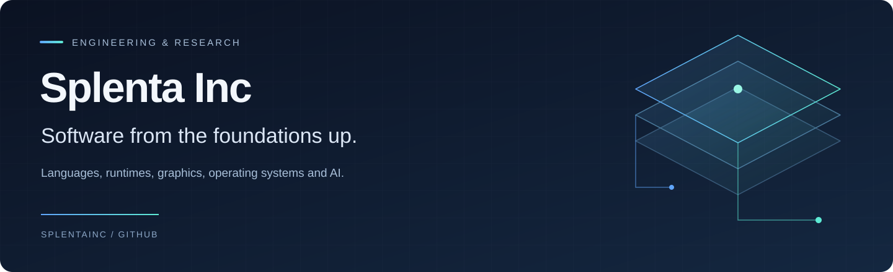

  

  <a href="#our-projects">Our projects</a> &nbsp; · &nbsp;
  <a href="https://github.com/orgs/splentainc/repositories">All repositories</a> &nbsp; · &nbsp;
  <a href="#get-involved">Get involved</a>

 

We build across the computing stack: the languages developers write, the runtimes and graphics that power applications, and the systems people use. Alongside that work, we explore how AI can reason over facts and make its answers easier to trace.

## Our projects

<table>
  <tr>
    <td width="50%" valign="top">
      <h3><a href="https://github.com/splentainc/cerlus">Cerlus ↗</a></h3>
      
BROWSER &nbsp; · &nbsp; PRIVATE REPOSITORY

      
An AI-native browser built in Rust, bringing GPU rendering, chat, and agent workflows into the browsing experience.

    </td>
    <td width="50%" valign="top">
      <h3><a href="https://github.com/splentainc/detir">Detir ↗</a></h3>
      
UI RUNTIME &nbsp; · &nbsp; PRIVATE REPOSITORY

      
A Rust UI runtime that turns structured intermediate representations into GPU-accelerated interfaces, including web-style and AI-generated views.

    </td>
  </tr>
  <tr>
    <td width="50%" valign="top">
      <h3><a href="https://github.com/splentainc/jag">Jag ↗</a></h3>
      
GRAPHICS &amp; UI &nbsp; · &nbsp; PUBLIC REPOSITORY

      
A GPU-accelerated 2D renderer and UI toolkit for Rust, combining wgpu rendering with composable elements and flexible layouts.

    </td>
    <td width="50%" valign="top">
      <h3><a href="https://github.com/splentainc/arth">Arth ↗</a></h3>
      
PROGRAMMING LANGUAGE &nbsp; · &nbsp; PUBLIC REPOSITORY

      
A systems programming language exploring familiar syntax, ownership, and compile-time memory safety without a garbage collector.

    </td>
  </tr>
  <tr>
    <td width="50%" valign="top">
      <h3><a href="https://github.com/splentainc/orus">Orus OS ↗</a></h3>
      
OPERATING SYSTEM &nbsp; · &nbsp; PUBLIC REPOSITORY

      
A Debian-based operating system project with a Rust desktop shell, application management tools, and distribution build tooling.

    </td>
    <td width="50%" valign="top">
      <h3><a href="https://github.com/splentainc/resocor">Resocor ↗</a></h3>
      
AI &amp; REASONING &nbsp; · &nbsp; PRIVATE REPOSITORY

      
Research and engineering for fact-grounded reasoning, with temporal data, traceable sources, and deterministic decision logic.

    </td>
  </tr>
</table>

## Get involved

Explore the public repositories for documentation, setup instructions, and current project status. Bug reports, technical questions, and contributions belong in the relevant project's issues and pull requests.

Private repository links require access. Licensing and contribution guidance are maintained in each project.
